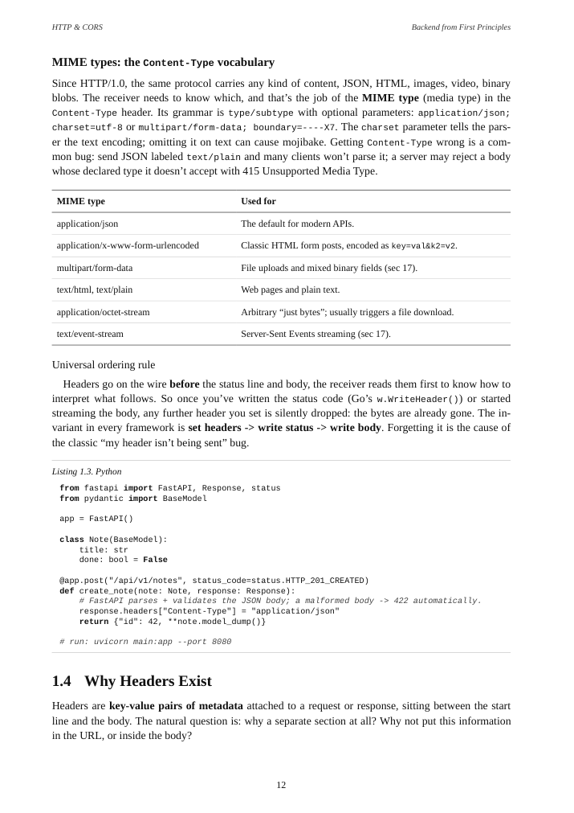

# Backend from First Principles — printable editions

English-language Go and Python PDFs of the 27-chapter reference, formatted for A4 printing. Both print designs are preserved in GitHub Releases.

## Download

### Revised textbook layout — v2.0.0

Times-style serif text, conventional section and figure numbers, plain tables, monochrome code listings and colour retained in the original diagrams. The teaching content is unchanged.

- [Go PDF — 630 pages](https://github.com/MagnusCarlsen26/backend-from-first-principles-pdf/releases/download/v2.0.0/Backend-from-First-Principles-Go-A4.pdf) · [Six-part printing bundle](https://github.com/MagnusCarlsen26/backend-from-first-principles-pdf/releases/download/v2.0.0/Go-Print-in-Parts.zip)
- [Python PDF — 619 pages](https://github.com/MagnusCarlsen26/backend-from-first-principles-pdf/releases/download/v2.0.0/Backend-from-First-Principles-Python-A4.pdf) · [Six-part printing bundle](https://github.com/MagnusCarlsen26/backend-from-first-principles-pdf/releases/download/v2.0.0/Python-Print-in-Parts.zip)

[Release notes and all assets](https://github.com/MagnusCarlsen26/backend-from-first-principles-pdf/releases/tag/v2.0.0) · [Printing guide](docs/printing-guide-v2.md) · [Checksums](docs/checksums-v2.0.0.txt)

### Original print design — v1.0.0

The earlier design with coloured headings and panels, syntax highlighting and separate chapter-opening pages.

- [Go PDF — 694 pages](https://github.com/MagnusCarlsen26/backend-from-first-principles-pdf/releases/download/v1.0.0/Backend-from-First-Principles-Go-A4.pdf) · [Six-part printing bundle](https://github.com/MagnusCarlsen26/backend-from-first-principles-pdf/releases/download/v1.0.0/Go-Print-in-Parts.zip)
- [Python PDF — 680 pages](https://github.com/MagnusCarlsen26/backend-from-first-principles-pdf/releases/download/v1.0.0/Backend-from-First-Principles-Python-A4.pdf) · [Six-part printing bundle](https://github.com/MagnusCarlsen26/backend-from-first-principles-pdf/releases/download/v1.0.0/Python-Print-in-Parts.zip)

[Release notes and all assets](https://github.com/MagnusCarlsen26/backend-from-first-principles-pdf/releases/tag/v1.0.0) · [Printing guide](docs/printing-guide-v1.md) · [Checksums](docs/checksums-v1.0.0.txt)

Both versions include all 27 chapters, 243 diagrams, 126 tables, 313 selected code blocks and 434 bookmarks per language. PDFs are release assets rather than Git objects. Print on A4 at 100%, with automatic orientation and long-edge binding for two-sided printing.

## Source and attribution

The educational content is by [DsThakurRawat and contributors](https://github.com/DsThakurRawat/Backend-from-first-Principle). This repository provides a print adaptation; it does not claim authorship of the lessons.

- [Original website](https://backend-from-first-principle.vercel.app/)
- Upstream snapshot: `aeb1230357a968bc6cea5e854db2d496de125f0a`
- `source/` is the upstream repository, pinned as a Git submodule.

Each language edition selects the corresponding website tabs. Shared SQL, protocol messages, commands and configuration are retained, as are standalone examples explaining another runtime.

## Rebuilding

```sh
git clone --recurse-submodules https://github.com/MagnusCarlsen26/backend-from-first-principles-pdf.git
cd backend-from-first-principles-pdf
cd source
npm ci
npm run build
cd ..
uv venv .venv
uv pip install --python .venv/bin/python -r requirements.txt
npm ci --prefix tools
.venv/bin/python tools/build_book.py --diagrams-only
node tools/fit_diagrams.mjs
.venv/bin/python tools/build_book.py --languages go python --render
.venv/bin/python tools/check_books.py
.venv/bin/python tools/package_editions.py
```

For an existing checkout, initialise the upstream source with `git submodule update --init --recursive`. To reproduce a particular design, check out its release tag first, then update the submodule.

System dependencies: Chromium, Pango/Harfbuzz, Noto Sans, Noto Serif and JetBrains Mono for the diagrams. The tools use `/usr/bin/chromium` and explicit Linux font paths; adjust these paths for another system.

## Repository layout

- `tools/`: print layout, diagram measurement, source checks and release packaging.
- `docs/`: release notes, printing guides and artifact checksums.
- `source/`: pinned upstream source.
- `editions/`: generated PDFs and printing bundles, ignored by Git and distributed as release assets.
- `build/` and `.venv/`: local intermediate files and Python environment, ignored by Git.

Exports validate standalone SVG files and stop on rendering errors. Content checks compare all chapter prose and selected code against the rendered upstream source, then check diagrams, tables, section counts, bookmarks, internal targets and page boundaries. Individual printing parts preserve the full book's printed page numbers; use the full PDF for links across parts.

The textbook layout additionally uses Liberation Serif and Liberation Mono. Font file locations are declared in `tools/print.css`.

## Revised page sample


